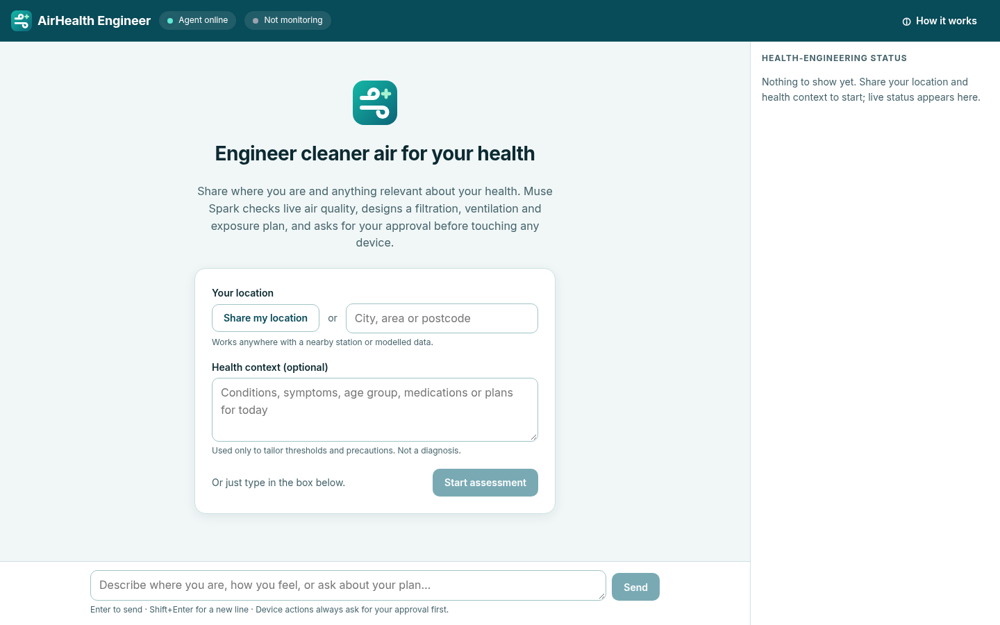
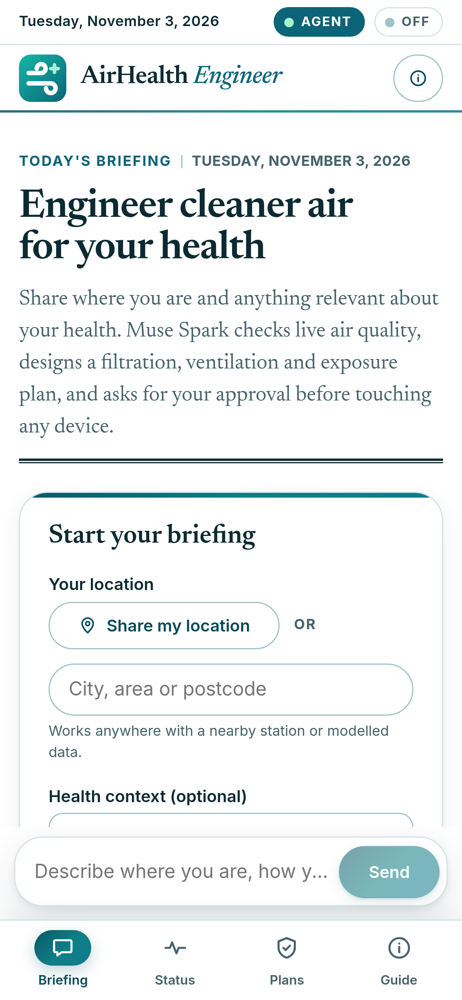

<p align="center">
  
</p>

# AirHealth Engineer

An autonomous agent that works where **engineering meets health**. You say where you are and what matters about your health. The agent:

1. checks live air quality there
2. designs an engineered indoor-air intervention (filtration sizing from CADR and air changes, a ventilation schedule, exposure guidance)
3. asks you to approve each device action before anything moves
4. keeps watching the air and tells you only when something is worth it

**Meta Muse Spark** (through the Meta Model API) is the only LLM. It plans, calls the tools, explains its reasoning, and decides whether a monitoring change deserves a notification.

> Not medical advice. The agent explains environmental exposure and engineering controls. It doesn't diagnose or prescribe.



<details><summary>Mobile empty state</summary>


</details>

---

## Contents

- [How it works](#how-it-works)
- [Quick start (local)](#quick-start-local)
- [Keys and configuration](#keys-and-configuration)
- [Deploy to Vercel](#deploy-to-vercel)
- [Prompt templates](#prompt-templates)
- [The approval sequence](#the-approval-sequence)
- [API reference](#api-reference)
- [Architecture](#architecture)
- [Design system](#design-system)
- [Logo](#logo)
- [Testing](#testing)
- [Confirmed facts and open questions](#confirmed-facts-and-open-questions)

---

## How it works

The UI explains this too (header → **How it works**).

| Step | What happens | Tool / route |
| --- | --- | --- |
| 1. You describe | A location (any city, area, postcode, or browser geolocation) plus any health context: conditions, symptoms, age group, plans. | `POST /api/agent` |
| 2. Muse Spark plans | The model reads the conversation and decides which tools to call. It asks only for the minimum it still needs. | Meta Model API `/chat/completions` (streamed) |
| 3. Real data | Places are geocoded worldwide (Open-Meteo, no key needed). The nearest **OpenAQ v3** station readings are fetched. If no station is within 25 km, CAMS modelled data is used and labelled **Modelled**. | `getAirQuality`, `getHealthContext` |
| 4. Engineered plan | Room volume → required clean-air delivery rate (CADR, m³/h and CFM) for the target air changes per hour, filter class, ventilation schedule, exposure guidance, and the device commands that would carry it out. | `designIntervention` |
| 5. Approval gate | Every device command pauses the run. The pending action is persisted, and nothing runs until you **Approve** or **Reject**. Approvals expire (`APPROVAL_TTL_MINUTES`). | `executeDeviceAction`, `/api/approvals/:id/*` |
| 6. Execute or simulate | Approved commands run through the configured adapter. **Sandbox** (the default) simulates and records state. Home Assistant and a signed webhook are the real adapters. | device adapters |
| 7. Keep monitoring | The client re-checks every 5 min while the tab is visible. Vercel Cron re-checks in the background. A manual **Re-check now** button is available. Muse Spark compares the new reading with your thresholds and decides whether it's worth interrupting you. If it is, a **Monitoring update** appears in the chat. | `POST /api/sessions/:id/monitor`, `GET /api/cron/monitor` |

A combined status (air × health × interventions → `ok | watch | act | unknown`) and the journey are always visible in the status panel. On mobile, the panel opens as a drawer. Everything there comes from `getStatus` / session state, and nothing in it is seeded.

Each conversation has its own memory, stored server-side: messages, location, health profile, interventions, approvals, device state and air-quality history. The client only keeps the conversation id (in `localStorage`), so a reload restores the chat.

**Graceful fallbacks**
- Geocoder failure: the tool returns an error, and the model asks you to clarify.
- OpenAQ down or no station: modelled data, labelled as modelled.
- No data at all: an honest "no data" error. Nothing is fabricated.
- Meta 429/5xx: retries with backoff that honours `Retry-After`, then a retryable notice with a **Retry** button.
- KV not configured: in-memory store (fine locally; not durable on serverless).

---

## Quick start (local)

Requirements: Node ≥ 20.9 (tested on Node 24) and npm.

```bash
npm install
cp .env.example .env.local      # then fill in at least MODEL_API_KEY (and ideally OPENAQ_API_KEY)
npm run dev                     # http://localhost:3000
```

Production build locally:

```bash
npm run build && npm start
```

Check the configuration (shows which keys are present, never their values):

```bash
curl -s localhost:3000/api/health | jq
```

Run every check at once: `npm run check` (lint → typecheck → tests → build).

---

## Keys and configuration

Everything is in [`.env.example`](.env.example). The important keys:

| Variable | Required | Notes |
| --- | --- | --- |
| `MODEL_API_KEY` | **yes** | Meta Model API key from the Model API dashboard → API keys (keys start with `LLM_`). See https://dev.meta.ai/docs/authentication |
| `META_MODEL_ID` | no | Default `muse-spark-1.3`. Also `muse-spark-1.2` and `muse-spark-1.1`. See https://dev.meta.ai/docs/models |
| `META_API_BASE_URL` | no | Default `https://api.meta.ai/v1` |
| `META_REASONING_EFFORT` | no | `minimal`/`low`/`medium`/`high`/`xhigh`, or empty for the model default |
| `META_TIMEOUT_MS`, `META_MAX_RETRIES`, `META_PARALLEL_TOOL_CALLS` | no | Timeouts and retries for the client |
| `AGENT_MAX_ITERATIONS`, `AGENT_RUN_BUDGET_MS`, `TOOL_TIMEOUT_MS`, `APPROVAL_TTL_MINUTES` | no | Limits for the agent loop |
| `OPENAQ_API_KEY` | recommended | Free key: https://explore.openaq.org/register (sent as `X-API-Key`). Without it, only modelled data is available. |
| `AIR_QUALITY_MODEL_FALLBACK` | no | `true` by default. Uses Open-Meteo/CAMS modelled data when no station is in range. |
| `GEOCODING_BASE_URL`, `AIR_QUALITY_MODEL_BASE_URL`, `OPENAQ_BASE_URL` | no | Upstream base URLs. Override only for proxies. |
| `UPSTASH_REDIS_REST_URL` + `UPSTASH_REDIS_REST_TOKEN` (or `KV_REST_API_URL` + `KV_REST_API_TOKEN`) | **yes on Vercel** | Durable state. Without these, an in-memory store is used. |
| `API_AUTH_TOKEN` | recommended in prod | When set, every route except `/api/health` requires `Authorization: Bearer <token>`. The UI asks for it once and keeps it in `localStorage`. |
| `CRON_SECRET` | for background monitoring | Vercel sends it as `Authorization: Bearer …`. The cron route refuses to run without it. `openssl rand -hex 32` |
| `MONITOR_MIN_INTERVAL_MINUTES`, `MONITOR_MAX_SESSIONS_PER_RUN` | no | Throttling for monitoring |
| `DEVICE_ADAPTER` | no | `sandbox` (default), `homeassistant`, or `webhook` |
| `HOME_ASSISTANT_URL`, `HOME_ASSISTANT_TOKEN` | for HA | A long-lived access token. `deviceId` must be the HA `entity_id`. |
| `DEVICE_WEBHOOK_URL`, `DEVICE_WEBHOOK_SECRET` | for webhook | The body is HMAC-SHA256 signed in `X-AirHealth-Signature` |
| `NEXT_PUBLIC_SITE_URL` | no | Absolute URL for Open Graph links. On Vercel, `VERCEL_PROJECT_PRODUCTION_URL` is used automatically. |
| `LOG_LEVEL` | no | `debug`/`info`/`warn`/`error`. Logs are structured JSON lines with request ids. |

---

## Deploy to Vercel

1. Push the repo to GitHub and import it in Vercel. The framework is detected as Next.js, and no build settings need changing.
2. Add an Upstash Redis integration from the Vercel Marketplace (it injects `KV_REST_API_URL`/`KV_REST_API_TOKEN`), or set the `UPSTASH_REDIS_REST_*` variables yourself.
3. Set the environment variables: `MODEL_API_KEY`, `OPENAQ_API_KEY`, `CRON_SECRET`, and optionally `API_AUTH_TOKEN` and the `DEVICE_*` variables.
4. Deploy, then open `https://<your-app>/api/health`. Every `configured` value should be `true`, and `storage.durable` should be `true`.

**Cron.** [`vercel.json`](vercel.json) schedules `GET /api/cron/monitor` once a day (`0 6 * * *`). That's the most a Hobby plan allows. On Pro you can tighten it, for example to `*/15 * * * *`. Between cron runs, an open tab re-checks every 5 minutes. `MONITOR_MIN_INTERVAL_MINUTES` throttles both paths.

Route `maxDuration` is 300 s. `AGENT_RUN_BUDGET_MS` (default 270 s) keeps each run inside that limit.

---

## Prompt templates

These are templates, so fill in your own details. The app has no built-in cities or example conversations.

- `I'm in <your city> with <condition>. Is it safe to <activity> today, and what should I change at home?`
- `I'm in <city, country>. My <child / parent> has <condition> and sleeps in a <length × width> m bedroom with <device>. Plan tonight.`
- `I live near <area / postcode>. I'm <age group>, <pregnant / managing condition>. Design a filtration and ventilation plan for my <room>.`
- `I'm at <place> and my <symptom> got worse this afternoon. What's the air like and what can I do right now?`
- `Re-check the air for me and only tell me if it changes my plan.`
- Device setup: `My purifier is <Home Assistant entity_id, e.g. fan.<name>>, and my HVAC is climate.<name>.`

---

## The approval sequence

No device command is executed without an explicit human decision.

```
user message ─▶ /api/agent (stream)
   Muse Spark ─▶ getAirQuality / getHealthContext / designIntervention
   Muse Spark ─▶ executeDeviceAction(command, reason)
                    │
                    ├─ args validated with zod (invalid → tool error back to the model)
                    ├─ Approval{id, status:"pending", command, reason, expiresAt} persisted
                    ├─ run status → "awaiting_approval"; pending turn persisted
                    └─ stream emits `data-approval` and finishes          ◀── run is PAUSED
UI shows Approval card + modal (composer disabled; new messages get 409)
   ├─ POST /api/approvals/:id/approve  { decidedBy?, note? }
   │     → adapter.execute(command)   (sandbox | homeassistant | webhook)
   │     → result fed back to Muse Spark as the tool result → run continues
   └─ POST /api/approvals/:id/reject   { reason?, decidedBy? }
         → tool result "rejected by user: <reason>" → run continues without acting
Second decision → 409. Expired approval → 410 and the tool result says it expired.
```

Add `?stream=ui` to approve or reject, and the continuation is streamed in AI SDK UI-message format. The chat UI uses this so the result appears in the same assistant message.

---

## API reference

All responses are JSON unless marked as a stream. Errors always use this shape:

```json
{ "error": { "code": "bad_request | unauthorized | not_found | conflict | gone | config_missing | upstream_error | upstream_timeout | internal_error | …", "message": "…", "details": {}, "requestId": "req_…" } }
```

Every response has an `x-request-id` header. If `API_AUTH_TOKEN` is set, send `Authorization: Bearer <token>` (not needed for `/api/health`, and the cron route uses `CRON_SECRET`).

| Method | Path | Body / query | Returns |
| --- | --- | --- | --- |
| GET | `/api/health` | none | Config **presence** for Meta, OpenAQ, storage, devices, auth and monitoring. Secrets are never echoed. |
| POST | `/api/agent` | `{ conversationId?, message? \| resume: true, location?, profile? }` (exactly one of `message`/`resume`) | **Stream** (AI SDK UI message stream). Parts: `text-*`, `tool-input-available`/`tool-output-available` (dynamic tools), `data-conversation {id}`, `data-approval`, `data-run {status, iterations}`, `data-notice {kind, message, retryable}`. 409 while an approval is pending. |
| GET | `/api/agent?conversationId=…` | none | `{ conversationId, messages: UIMessage[], status }`, used to restore the chat after a reload |
| POST | `/api/sessions` | `{ location?, profile?, userRef?, message? }` | `201 { sessionId, location, run }` (non-streaming API clients) |
| GET | `/api/sessions/:id` | none | Session: messages, context, interventions, device state |
| PATCH | `/api/sessions/:id` | `{ location?, profile?, replaceProfile? }` | Updates context without a chat turn (location is geocoded) |
| POST | `/api/sessions/:id/messages` | `{ message }` | Run result, non-streaming |
| POST | `/api/sessions/:id/resume` | none | Retries the last failed or interrupted run |
| GET | `/api/sessions/:id/status` | none | `getStatus` report: combined level, headline, reasons, air quality and history, health, interventions, approvals, device actions, monitoring |
| GET | `/api/sessions/:id/approvals` | `?status=pending` (optional) | Approvals for the conversation |
| POST | `/api/sessions/:id/monitor` | `{ force? }` | `{ sessionId, checked, refreshed, notified, decision?, error? }` (or `checked:false` with a `reason`). Throttled unless `force`. |
| GET | `/api/approvals/:id` | none | One approval |
| POST | `/api/approvals/:id/approve` | `{ decidedBy?, note? }`, `?stream=ui` optional | `{ approval, run }` (410 if expired, 409 if already decided), or a stream |
| POST | `/api/approvals/:id/reject` | `{ reason?, decidedBy? }`, `?stream=ui` optional | Same as approve |
| GET | `/api/interventions/:id` | none | One intervention plan |
| PATCH | `/api/interventions/:id` | `{ status: "completed" \| "cancelled" }` | Updated intervention |
| GET | `/api/cron/monitor` | header `Authorization: Bearer $CRON_SECRET` | `{ checked, notified, results }`. 401 with a wrong secret; `config_missing` if no secret is set. |

Example (non-streaming):

```bash
curl -s -X POST localhost:3000/api/sessions -H 'content-type: application/json' \
  -d '{"message":"I'\''m in <your city> with <condition>. What should I do today?"}' | jq '.run.status, .run.pendingApprovals'
curl -s -X POST localhost:3000/api/approvals/<approvalId>/approve -H 'content-type: application/json' -d '{"decidedBy":"me"}' | jq
```

---

## Architecture

```
src/
  app/
    page.tsx, layout.tsx            UI shell (Inter via next/font, metadata, theme colour)
    icon.svg, apple-icon.tsx, opengraph-image.tsx   generated from the single logo source
    api/**/route.ts                 routes listed above
  components/
    AgentApp.tsx                    useChat + custom transport (message / resume / approval), polling, restore
    layout/  Masthead, LeftRail, StatusSidebar (news-style status desk), HowItWorksDialog, AccessDialog
    cards/   ToolResultCard, AirQualityCard (+ Sparkline), InterventionPlanCard, HealthContextSummary,
             ApprovalRequestCard, ApprovalModal
    chat/    MessageBubble, Composer
    states/  EmptyState, Loading/Error/Success states
    brand/   Logo.tsx, logoGeometry.ts  ← single source of truth for the logo
  lib/
    meta/        Meta Model API client: chat completions, SSE parser, tool-call delta accumulator, retries
    agent/       loop (iterations, budget, tool timeouts, approval pause/resume), tools/*, prompt, monitor, status, uiStream
    services/    geocode (Open-Meteo), airQuality (OpenAQ v3 + CAMS fallback), aqi (US EPA breakpoints)
    devices/     sandbox | homeassistant | webhook adapters
    storage/     Upstash/Vercel KV store + in-memory fallback
    config.ts    zod-validated env;  logger.ts structured JSON logs;  api.ts route wrapper (auth, errors, request ids)
```

**Agent loop safeguards**
- `AGENT_MAX_ITERATIONS` and a wall-clock budget.
- Per-tool timeouts.
- zod validation of every tool argument. An invalid argument goes back to the model as a tool error and doesn't crash the run.
- Meta client retries 429/5xx with exponential backoff and honours `Retry-After`. It doesn't retry other 4xx errors.

---

## Design system

The interface reads like a **live news briefing** set inside a **design-editor workspace**. The editorial side gives you serif headlines, a masthead, hairline rules, kickers and "live" badges. The editor side gives you a rounded left rail, a white canvas, tile grids and a floating composer. Both are built from scratch; no third-party logos, names or assets are used.

- **Layout:**
  - **Masthead.** A dateline strip shows today's date, a one-line note and the live badges ("Agent online", "Live · Monitoring"). Below it sit the wordmark (the SVG logo plus a serif "AirHealth *Engineer*") and pill actions.
  - **Left rail.** Briefing, Status, Plans (interventions) and Guide (how it works). The pending-approval count shows on Plans.
  - **Canvas.** A white, soft-shadowed card holding the conversation.
    - Empty state: an editorial front page with a display headline, a standfirst, a double rule, a "Start your briefing" form and "In this briefing" tiles.
    - Once a briefing starts, the masthead headline follows the agent's current verdict.
  - **News sidebar ("The status desk").** Four ruled sections:
    - Air now
    - Your health context
    - Interventions
    - Engineering status
- **Tokens:** CSS variables in [`src/app/globals.css`](src/app/globals.css) cover colour, space, radius, type scale, shadow and motion.
  - Palette: deep teal (`--color-primary #0b6477`, ink `#0c2a31`) on soft blue-green surfaces.
  - Restrained gradients:
    - `--gradient-brand` (`#0a5868 → #0f7f86 → #13788f`) for primary pills, the active rail item and the masthead rule. White text stays ≥ 4.7:1 at every stop.
    - `--gradient-soft` for your own messages.
  - Approval accent: blue-teal `#0b5f7f`.
  - Status: `ok` teal, `watch` amber, `act` orange. **Red only for true warnings** (hazardous air, errors).
  - Radii: 12, 18 and 24 px plus pills. Three shadow levels, including a `float` shadow for the composer toolbar.
- **Type:** both via `next/font/google`.
  - **Newsreader** (serif, optical sizes and italics) for the wordmark, headlines, section heads, card titles, readings and the agent's prose.
  - **Inter** for UI, labels and data.
- **Editorial primitives:** `.kicker` (uppercase label with a hairline separator), `.dateline`, `.rule` and `.rule-double`, `.standfirst`, and `.live` badges with a pulsing dot.
- **Components:**
  - Masthead and LeftRail
  - ToolResultCard
  - AirQualityCard, with a sparkline of real readings that appears after the second reading
  - InterventionPlanCard
  - HealthContextSummary
  - ApprovalRequestCard and ApprovalModal (native `<dialog>`, focus-trapped, Esc to close)
  - StatusSidebar
  - Empty, loading, error and success states
  - SVG logo, from a single source (see [Logo](#logo))
- **No demo data:** the sidebar shows plain placeholder text until a real reading, health context or plan exists. The tiles explain the method; they never show sample numbers.
- **Accessibility:**
  - Landmarks: `header`, `nav` (the rail), `main`, `aside`.
  - A skip link.
  - The chat log is `role="log"` with `aria-live="polite"`, and the status hero is a live region too.
  - Rail buttons use `aria-current`, and Status and Plans move focus to the matching sidebar section.
  - Every icon button has a label.
  - Visible focus rings, and text and UI colours meet WCAG AA contrast.
  - `prefers-reduced-motion` disables the pulses, transitions and smooth scrolling.
- **Responsive:**
  - **Above 1180 px:** three columns: rail, canvas, sidebar.
  - **1180 px and below:** the sidebar becomes a drawer, with a backdrop and Esc to close.
  - **760 px and below:** the rail becomes a bottom tab bar and the canvas runs edge to edge.
  - **440 px and below:** button labels and badge text shorten.

---

## Logo

Concept A was chosen from three:

| Concept | File |
| --- | --- |
| **A. Airflow tile (chosen)** | `docs/logo/concepts/concept-a-airflow-tile.svg` |
| B. Breathing lungs | `docs/logo/concepts/concept-b-breathing-lungs.svg` |
| C. Hex pulse | `docs/logo/concepts/concept-c-hex-pulse.svg` |

Contact sheet: `docs/logo/concepts/contact-sheet.png`.

**Why A:**
- Airflow curls are a clear "air" sign, and the small plus reads as "health". Neither depends on an anatomical shape.
- It stays legible at 16 px.
- It works in one colour.

Concept B lost detail at favicon size. Concept C read as generic tech.

**Single source of truth:** `src/components/brand/logoGeometry.ts`. Everything else is generated from it:
- `Logo.tsx` (in-app)
- `src/app/icon.svg` (favicon)
- `apple-icon.tsx`
- `opengraph-image.tsx`
- `docs/logo/final.svg`
- `docs/logo/final-{16,32,180,512}.png` and `final-contact-sheet.png`

After changing the geometry, run:

```bash
npm run logo          # regenerate icon.svg + docs/logo/final.svg
npm run logo -- --png # also re-render the PNG sizes (uses Playwright + Chrome)
```

A unit test fails if `icon.svg` or `final.svg` drift from the source.

---

## Testing

```bash
npm test          # vitest
npm run typecheck
npm run lint
```

- **Unit and integration tests:**
  - SSE parsing and tool-call delta accumulation
  - retry and backoff rules
  - config validation
  - CADR and ventilation engineering maths
  - AQI conversion
  - combined status
  - monitor decision parsing
  - approval gating (pause → approve/reject/expire → resume, double-decision 409)
  - logo sync
- **End-to-end** (`tests/e2e/`):
  - Real route handlers talk over real HTTP to a **scripted mock Muse Spark server** that speaks the Chat Completions SSE format, and to mock geocoding, OpenAQ and model air-quality servers.
  - Covered:
    - the full loop of message → tools → plan → approval pause → approve → execute → final answer
    - restore
    - forced monitoring with a notification
    - cron auth
    - Meta 429 → retryable notice → resume
    - fallbacks: geocoder failure, OpenAQ down, no data
  - The mocks exist only under `tests/`. App code always calls the configured real endpoints.
- **Optional live check:** `OPENAQ_API_KEY=… npx vitest run tests/live-openaq.test.ts` calls the real OpenAQ API. It is skipped when no key is set, and `LIVE_TEST_CITY` sets the place used.

---

## Confirmed facts and open questions

**Confirmed from Meta's docs** (dev.meta.ai):
- **Endpoint and auth:** base `https://api.meta.ai/v1`, `POST /chat/completions`, `Authorization: Bearer $MODEL_API_KEY`.
  - https://dev.meta.ai/docs/api-reference
  - https://dev.meta.ai/docs/authentication
- **Models:** `muse-spark-1.3` (latest), `muse-spark-1.2` and `muse-spark-1.1`. https://dev.meta.ai/docs/models
- **Tool calling:**
  - OpenAI-style `tools: [{type:"function", function:{…}}]`; `tool_choice` supports `"auto"`; `parallel_tool_calls` is supported.
  - The assistant `tool_calls` message is followed by one `tool` message per call.
  - The `developer` role is supported.
  - https://dev.meta.ai/docs/protocols/tool-calling
  - https://dev.meta.ai/docs/cookbook/tool-function-calling
- **Streaming:** SSE `data:` chunks ending in `[DONE]`; tool-call deltas are accumulated by `index`.
  - https://dev.meta.ai/docs/protocols/chat-completions
  - https://dev.meta.ai/docs/api-reference/chat-completions/schemas
- **`reasoning_effort` is supported.** `n>1`, `stop`, `logprobs` and the penalty parameters are not, so they are never sent.
- **Errors:** retry 429 and 5xx, honouring `Retry-After`; don't retry 400–413. https://dev.meta.ai/docs/error-handling

**Unconfirmed or configurable:**
- **Meta Model API dashboard URL.** Key creation is described in the docs ("Model API dashboard → API keys"). Its exact URL isn't linked here.
- **Chat Completions vs the Responses API.** Chat Completions doesn't carry the model's reasoning across turns, and Meta recommends the Responses API for multi-turn reasoning. This app uses Chat Completions (stable, documented tool calling) and keeps conversation memory server-side. Moving to Responses is a contained change in `src/lib/meta/`.
- **OpenAQ distance.** Station selection uses `/v3/locations?coordinates=…&radius≤25000`. Distance is computed locally rather than relying on a response field.
- **Home Assistant fresh-air dampers** have no standard climate service. They are mapped to a `number.set_value` entity.
- **AI SDK v7.** UI-stream part names were checked against the installed `ai@7` / `@ai-sdk/react@4` types. Future majors may rename them.
- **Vercel Hobby cron** runs at most once a day, which is why the client also polls.
- **Inter** is fetched from Google Fonts at build time by `next/font`. Builds need network access.
