<p align="center">
  
</p>

# AirHealth Engineer

**An agent that engineers your indoor air, not medical advice.** AirHealth Engineer closes the loop between sensing and a physical system. You speak, snap your room or type where you are, and the agent:

1. senses: live outdoor air (OpenAQ, CAMS), the 72-hour CAMS forecast, and your photo of the room (Muse Spark scene analysis plus SAM 3.1 outlines of haze, windows, vents and purifiers)
2. plans: an engineered intervention (CADR sizing from room volume and air changes, a ventilation schedule, filter class) and an hour-by-hour 72-hour device plan
3. asks you to approve every device action before anything moves (purifier, windows, HVAC)
4. controls the devices through Home Assistant, a signed webhook, Web Bluetooth or the sandbox, then keeps monitoring and only interrupts you when the air changes enough to matter

**Push the Frontier:** a Meta-model agent that drives a real physical system behind human approval gates. **Build for Your World:** it works anywhere on Earth (no seeded city or data), and was built in Ilorin, Nigeria with Lagos haze and harmattan dust in mind.

Every model call goes to **Meta models only** (the Meta Model API, `https://api.meta.ai/v1`): Muse Spark, SAM 3.1, Muse Voice Transcribe and Muse Image. Each endpoint has a capability check and an honest fallback.

> Not medical advice. The agent controls environment and devices: exposure, filtration and ventilation. Your optional **sensitivity profile** only tunes device thresholds. It doesn't diagnose or prescribe. Seek urgent care for severe symptoms.


<details><summary>Mobile and light mode</summary>


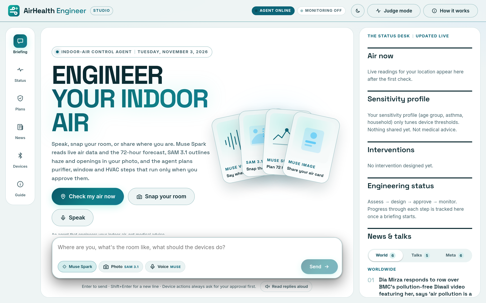
</details>

<details><summary>A live session (Ikeja, real OpenAQ reading, nothing seeded)</summary>

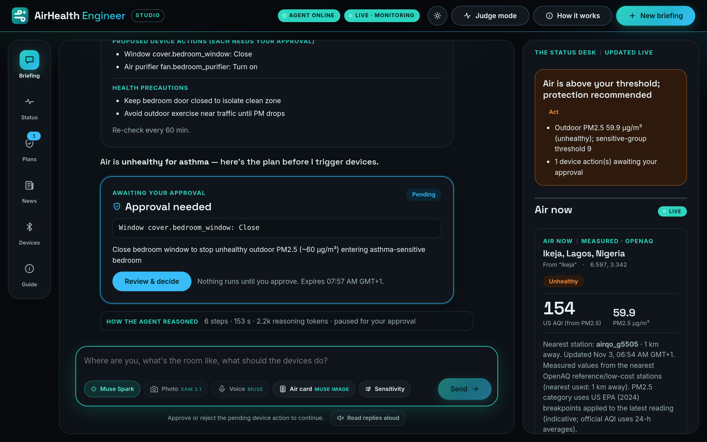

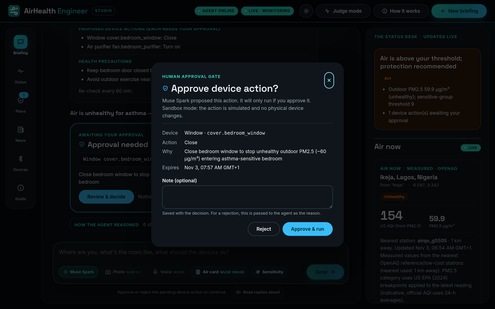

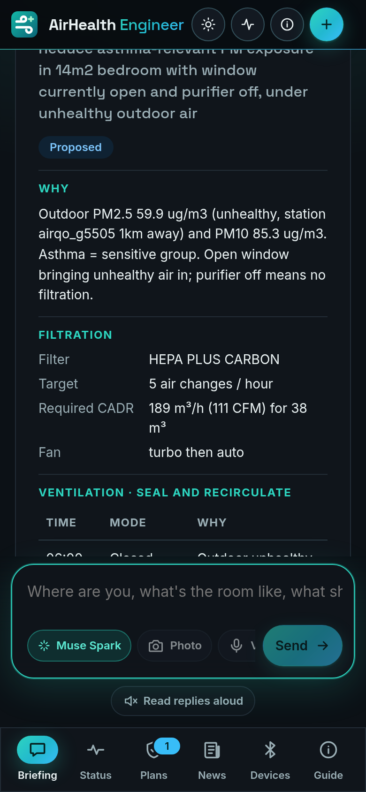

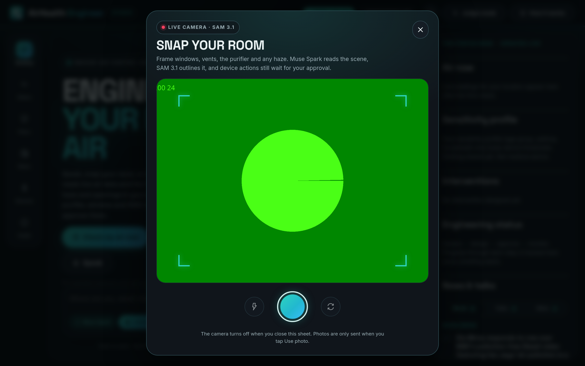

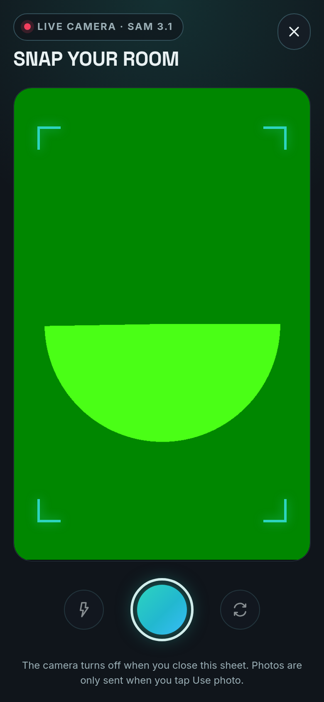
</details>

<details><summary>Air twin, live camera mode and smart plug</summary>

The indoor plan card with the air twin: a modelled before/after PM2.5 curve and the time to reach the target. The screenshot uses a scripted session (real `designIntervention` output for Ikeja; the model reply was stubbed). Nothing is seeded in the app.

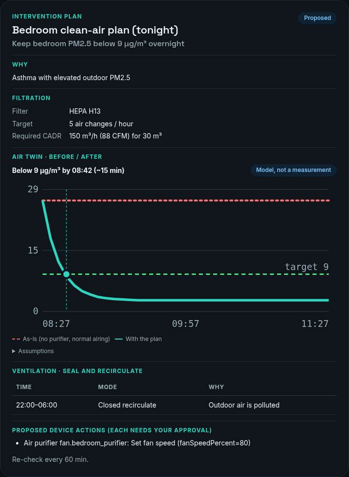

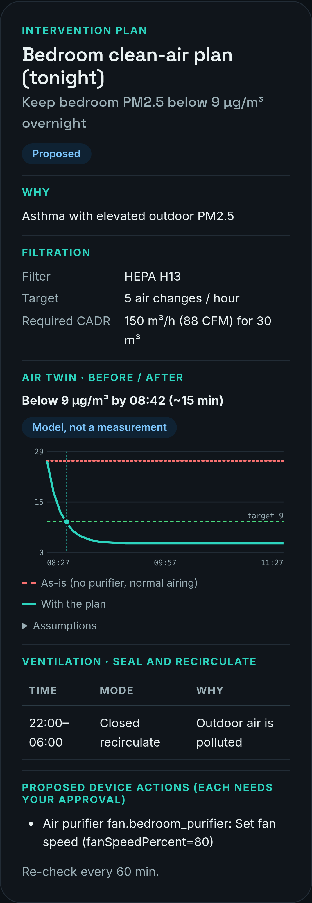

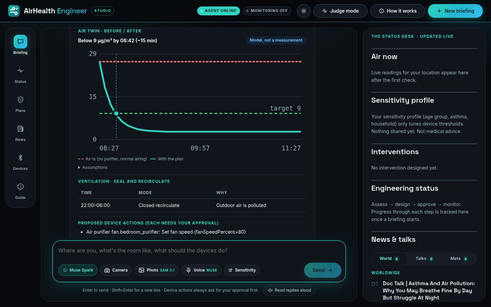

Live camera mode: the scene is read again only when the frame changes (synthetic test feed shown).

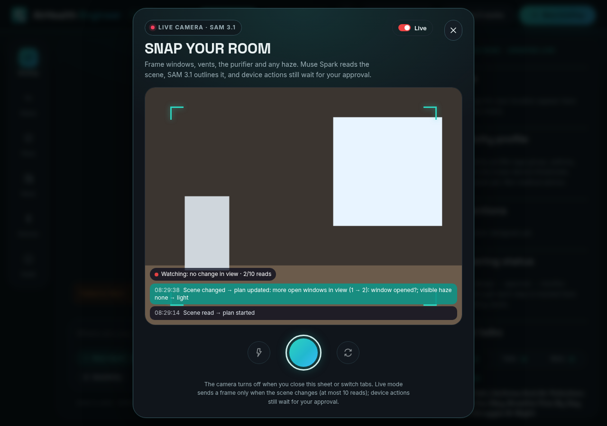

Devices → Smart plug, with no plug connected (purifier power stays in the sandbox):

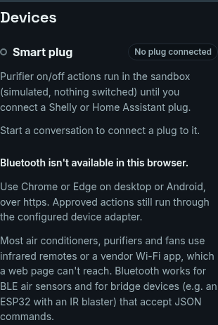
</details>

---

## Contents

- [How it works](#how-it-works)
- [Meta models used](#meta-models-used)
- [Built during the hackathon](#built-during-the-hackathon)
- [Location, voice, news and Bluetooth](#location-voice-news-and-bluetooth) (plus sensitivity chips and quick starts)
- [Smart plug setup](#smart-plug-setup)
- [Quick start (local)](#quick-start-local)
- [Keys and configuration](#keys-and-configuration)
- [Deploy to Vercel](#deploy-to-vercel)
- [Prompt templates](#prompt-templates)
- [The approval sequence](#the-approval-sequence)
- [API reference](#api-reference)
- [Architecture](#architecture)
- [Design system](#design-system)
- [Logo](#logo)
- [Testing](#testing)
- [Confirmed facts and open questions](#confirmed-facts-and-open-questions)

---

## How it works

The UI explains this too (header → **How it works**).

| Step | What happens | Tool / route |
| --- | --- | --- |
| 1. You describe | Speak (Muse Voice Transcribe, Web Speech fallback), snap the room live with the in-app **Camera** (rear camera, switch, torch) or upload a photo or short video, or type a location (any city, area, postcode, or browser geolocation). An optional sensitivity profile (household, age group, sensitivities) only tunes device thresholds. | `POST /api/transcribe`, `POST /api/vision`, `POST /api/agent` |
| 1b. Photo → scene | Muse Spark returns a structured scene (haze level, openings, vents, purifier, room size estimate) and SAM 3.1 outlines each region. The scene feeds the device plan: e.g. close the open window it found, size the purifier to the room it estimated. | `POST /api/vision` |
| 2. Muse Spark plans | The model reads the conversation and decides which tools to call. It asks only for the minimum it still needs. | Meta Model API `/chat/completions` (streamed) |
| 3. Real data | Places are geocoded worldwide (Open-Meteo, with OpenStreetMap Nominatim for postcodes and addresses; no keys needed). Shared coordinates are reverse-geocoded to a readable place. The nearest **OpenAQ v3** stations are ranked by distance, widening from 25 km up to 100 km when nothing closer reports. If no station reports, or every nearby station is stale (some report only years-old readings), CAMS modelled data is used and labelled **Modelled**. | `getAirQuality`, `getHealthContext` |
| 3b. 72-hour plan | The CAMS hourly forecast for your coordinates goes to Muse Spark with a strict `json_schema`; it returns a timeline of device steps (purifier speed, windows, HVAC) for the worst hours. Each step has its own Approve button. Rules-based plan if the planner is unavailable. | `planForecast` |
| 4. Engineered plan | Room volume → required clean-air delivery rate (CADR, m³/h and CFM) for the target air changes per hour, filter class, ventilation schedule, exposure guidance, and the device commands that would carry it out. | `designIntervention` |
| 5. Approval gate | Every device command pauses the run. The pending action is persisted, and nothing runs until you **Approve** or **Reject**. Approvals expire (`APPROVAL_TTL_MINUTES`). | `executeDeviceAction`, `/api/approvals/:id/*` |
| 6. Execute or simulate | Approved commands run through the configured adapter. **Sandbox** (the default) simulates and records state. Home Assistant and a signed webhook are the real adapters. A **smart plug** (Shelly or a Home Assistant switch) handles purifier on/off when one is connected. | device adapters, smart plug |
| 7. Keep monitoring | The client re-checks every 5 min while the tab is visible. Vercel Cron re-checks in the background. A manual **Re-check now** button is available. Muse Spark compares the new reading with your thresholds and decides whether it's worth interrupting you. If it is, a **Monitoring update** appears in the chat. | `POST /api/sessions/:id/monitor`, `GET /api/cron/monitor` |

A combined status (air × health × interventions → `ok | watch | act | unknown`) and the journey are always visible in the status panel. On mobile, the panel opens as a drawer. Everything there comes from `getStatus` / session state, and nothing in it is seeded.

Each conversation has its own memory, stored server-side: messages, location, health profile, interventions, approvals, device state and air-quality history. The client only keeps the conversation id (in `localStorage`), so a reload restores the chat.

**Graceful fallbacks**
- Geocoder failure: the tool returns an error, and the model asks you to clarify.
- OpenAQ down or no station: modelled data, labelled as modelled.
- No data at all: an honest "no data" error. Nothing is fabricated.
- Meta 429/5xx: retries with backoff that honours `Retry-After`, then a retryable notice with a **Retry** button.
- KV not configured: in-memory store (fine locally; not durable on serverless).

---

## Meta models used

Only Meta models are called, all through `MODEL_API_KEY` against `https://api.meta.ai/v1`. `GET /api/capabilities` (public) probes each one, and Judge mode shows what is live and what is falling back.

| Model | Used for | Endpoint | Fallback when unavailable |
| --- | --- | --- | --- |
| **Muse Spark** (`muse-spark-1.3`, `META_MODEL_ID`) | The agent: tool calling, reasoning, monitoring decisions | `/chat/completions` (streamed) | Retry with backoff, then a retryable notice |
| **Muse Spark** vision, structured output | Scene analysis of your room photo or video frames | `/chat/completions` with `json_schema` | Text-only description, no device hints |
| **Muse Spark** planner, `json_schema` | 72-hour CAMS forecast device plan (`FORECAST_PLANNER_EFFORT`, default `high`) | `/chat/completions` | Deterministic rules plan |
| **SAM 3.1** (`sam-3.1`) | Masks for haze, windows, vents and purifiers on your photo | segmentation | Muse Spark grounding boxes |
| **Muse Voice Transcribe** (`muse-voice-transcribe-1.0`) | Push-to-talk speech to text | transcription | Browser Web Speech API |
| **Muse Image** (`muse-image-1.0`) | Background art for the "air today" card | image generation | Brand gradient card |

The open-weights Muse Glimmer and Muse Spark Open are allowed by the challenge but not used. No other model provider is called.

---

## Built during the hackathon

Everything in this repo was built during the hackathon. The first commit was on 2026-11-03 at 04:12 (+01:00, Africa/Lagos).

| Feature | Commit | Date (+01:00) |
| --- | --- | --- |
| Muse Spark agent with approval-gated device control, live air quality, monitoring | `05b2e5e` | 2026-11-03 04:12 |
| Location resolution, voice, news & talks, Web Bluetooth devices | `57f805a` | 2026-11-03 05:10 |
| Sensitivity suggestion chips and quick starts | `2b731cf` | 2026-11-03 05:41 |
| Muse Spark vision with structured output plus SAM 3.1 overlay | `abf551a` | 2026-11-03 06:23 |
| Muse Voice Transcribe with Web Speech fallback | `40d1b24` | 2026-11-03 06:25 |
| Reasoning timeline and Judge mode | `ed23823` | 2026-11-03 06:28 |
| 72-hour CAMS forecast plan with per-step approval (`json_schema`) | `1922a82` | 2026-11-03 06:36 |
| Muse Image "air today" card (share sheet or download only) | `538246a` | 2026-11-03 06:38 |
| Studio redesign: dark Canva × Higgsfield-style UI, prompt bar, gallery, sensitivity profile copy | `53ed25f` | 2026-11-03 06:48 |
| Live in-app camera: rear camera by default, switch and torch, captured frame goes to Muse Spark vision + SAM 3.1, Permissions-Policy `camera=(self)` | `e82b052` | 2026-11-03 07:40 |
| Exposure step wording, open-space plans without indoor sizing, ask for the sensitivity profile once | `af46a4f` | 2026-11-03 08:05 |
| Air twin: modelled before/after PM2.5 curve with time-to-target on indoor plan cards | `927770c` | 2026-11-03 08:12 |
| WhatsApp share on the air card: prefilled `wa.me` text plus the native share sheet with the card image | `8b817c2` | 2026-11-03 08:13 |
| Live camera mode: frame-diff change detection, scene re-read only on change, plan updates, cost guard | `fc6f193` | 2026-11-03 08:20 |
| Smart plug control: Shelly local RPC, Shelly Cloud and Home Assistant switch behind the approval gate, no-plug sandbox state | `7bd9bf7` | 2026-11-03 08:26 |

The 3-minute demo script is in [docs/demo-script.md](docs/demo-script.md).

---

## Location, voice, news and Bluetooth

**Sensitivity suggestions and quick starts**
- Under the sensitivity profile field, tap-to-toggle chips cover common contexts (asthma, allergies / hay fever, COPD, heart condition, pregnant, child at home, older adult 65+, diabetes, outdoor worker, runner) and how you feel today (coughing, wheezing, shortness of breath, headache, itchy eyes). Each chip is a button with `aria-pressed`; tapping adds or removes a plain phrase in the field, and typing the phrase yourself lights the chip up too.
- Selected chips are also sent as a structured profile (`conditions`, `symptoms`, `ageGroup`, `household`, `activities`) to `getHealthContext`, which tightens thresholds for sensitive household members and adds timing cautions for regular outdoor exposure. Chips describe context only; nothing is a diagnosis.
- Once a briefing is running, the **Sensitivity** chip in the prompt bar opens a compact chip row that keeps a single "My sensitivity profile: …" line in your message.
- **Quick start** prompts (check the air now with your location, plan a safer commute, set up the purifier for tonight, exercising outside) start a briefing in one tap. None names a fixed city.

**Location**
- **Use my location** checks for https and a denied permission first, then asks for a high-accuracy fix. If that times out it falls back to a coarse fix. Every failure has a plain message: denied, timeout, unavailable, insecure page or unsupported browser.
- Coordinates are reverse-geocoded (Nominatim, suburb level) and a timezone is looked up (Open-Meteo), so you see "Ikeja, Lagos, Nigeria ±30 m" rather than raw numbers.
- Typed places are previewed as you type (`GET /api/geocode`) and Start stays disabled until the place resolves. Names go to Open-Meteo first and postcodes or addresses (anything with a digit) go to Nominatim first, each falling back to the other. Ambiguous names prefer the country you typed, then the larger place.
- Stations are ranked by our own haversine distance, with recent reporters first. The search widens 15 → 25 → 100 km. The card shows the nearest station and its distance, and the note warns when it is more than 25 km away. If every station in range is stale, the card switches to labelled modelled values and the note names the last station reading date.
- The agent prompt carries the resolved place and coordinates. If you shared a precise fix, `getAirQuality` keeps it even when the model passes the town name back.

**Voice**
- The **Voice** chip records push-to-talk audio and sends it to **Muse Voice Transcribe** (`POST /api/transcribe`); the audio is not stored. If the model is unavailable it falls back to the browser Web Speech API (Chrome, Edge, Safari), and the chip shows which one is active (Muse / Web). Typing always works.
- **Read replies aloud** speaks Muse Spark's answers with `speechSynthesis`. It is off by default, stored per device, and stops when you send the next message.

**News & talks** (`GET /api/news?place=`)
- Four tabs: near you, worldwide, talks (webinars, podcasts, lectures, conferences) and Meta (Meta Newsroom and Engineering feeds plus Google News restricted to Meta's sites, filtered to AI for health, science and environment). Meta AI's blog has no RSS feed.
- Headlines come from Google News RSS and Meta's own RSS. They are filtered to air-quality topics, cached for 30 minutes, and always link to the original with its source and date. Nothing is generated. An empty or unreachable feed shows an honest note.

**Nearby devices (Web Bluetooth)**
- Chrome or Edge on desktop or Android, over https. Elsewhere the panel explains why it isn't available.
- **Connect device** opens the browser's own device chooser. The app discovers the GATT services and reads standard Environmental Sensing values (temperature, humidity, pressure, CO₂, PM1/PM2.5/PM10) plus battery. **Share with Muse Spark** sends the readings into the chat.
- If the device has a writable characteristic (for example a Nordic UART bridge), you can pick it as a target. After you **approve** a device action, and only then, the browser writes `{"type":"airhealth.command","approvalId":…,"command":…}` plus a newline in 20-byte packets. The approval dialog tells you when this will happen.
- Most air conditioners, purifiers and fans use infrared remotes or vendor Wi-Fi clouds, which a web page can't reach. Use a BLE bridge (for example an ESP32 with an IR blaster) or the Home Assistant adapter. The server-side sandbox, Home Assistant and webhook adapters are unchanged.

## Smart plug setup

Most purifiers can't be reached from a web app, but almost any purifier can be switched by a smart plug. Plug the purifier into a Shelly plug (or any plug Home Assistant exposes as a `switch.*`), set the purifier's own switch to on, and AirHealth Engineer turns it on and off for you.

- **Approval first, always.** A plug is only switched when you approve a purifier action in the chat. Saving settings and **Check connection** never switch anything (the check only reads the plug state).
- **Power only.** `turn_on` and `turn_off` switch the plug. `set_fan_speed` to 0% turns it off; any other speed or a mode turns it on, and the result says plainly that speed and mode have to be set on the purifier. Windows and HVAC still go to `DEVICE_ADAPTER`.
- **No faked success.** If the plug is offline, unreachable or returns an error, the approval is marked **failed** with the reason, and no device state is recorded.
- **No plug connected.** With nothing configured, the Devices panel says so and purifier actions run in the sandbox ("SANDBOX: simulated … No smart plug connected").

**Option 1: in the app (per conversation).** Open **Devices → Smart plug → Connect a plug**, pick a provider and save. Settings are stored server-side with the conversation; the cloud key is never sent back to the browser. Local hosts must be private LAN addresses (`10.x`, `172.16–31.x`, `192.168.x`, `*.local`), and cloud servers must be `shelly-<n>-<region>.shelly.cloud`.

**Option 2: environment variables (server-wide default).**

| Provider | Set | Call made after approval |
| --- | --- | --- |
| Shelly Cloud (works from Vercel) | `PLUG_PROVIDER=shelly_cloud`, `SHELLY_CLOUD_SERVER`, `SHELLY_CLOUD_AUTH_KEY`, `SHELLY_CLOUD_DEVICE_ID`, optional `SHELLY_CLOUD_CHANNEL` | `POST https://<server>/v2/devices/api/set/switch?auth_key=…` with `{"id","channel","on"}` |
| Shelly local RPC (Gen2/Gen3) | `PLUG_PROVIDER=shelly_local`, `SHELLY_HOST`, optional `SHELLY_SWITCH_ID` | `GET http://<ip>/rpc/Switch.Set?id=0&on=true` |
| Home Assistant | `PLUG_PROVIDER=homeassistant`, `PLUG_HA_ENTITY=switch.…`, `HOME_ASSISTANT_URL`, `HOME_ASSISTANT_TOKEN` | `POST /api/services/switch/turn_on` with `{"entity_id"}` |

Where to find the values:
- **Shelly Cloud:** in the Shelly app, *User settings → Authorization cloud key* shows the server (`shelly-XX-eu.shelly.cloud`) and the key. The Device Id is under *Device → Settings → Device information*. Shelly allows about one request per second.
- **Shelly local:** the plug's IP from your router or the Shelly app. Local RPC only works when this app runs on the **same network** (for example `npm run build && npm start` at home). A cloud deployment such as Vercel can't reach `192.168.x.x`, and an https page can't call an http device, so use Shelly Cloud for the hosted app.
- **Home Assistant:** a long-lived access token from your HA profile, and the plug's `switch.*` entity id. HA must be reachable from wherever this app runs (Nabu Casa or your own https URL for Vercel).

---

## Quick start (local)

Requirements: Node ≥ 20.9 (tested on Node 24) and npm.

```bash
npm install
cp .env.example .env.local      # then fill in at least MODEL_API_KEY (and ideally OPENAQ_API_KEY)
npm run dev                     # http://localhost:3000
```

Production build locally:

```bash
npm run build && npm start
```

Check the configuration (shows which keys are present, never their values):

```bash
curl -s localhost:3000/api/health | jq
```

Run every check at once: `npm run check` (lint → typecheck → tests → build).

---

## Keys and configuration

Everything is in [`.env.example`](.env.example). The important keys:

| Variable | Required | Notes |
| --- | --- | --- |
| `MODEL_API_KEY` | **yes** | Meta Model API key from the Model API dashboard → API keys (keys start with `LLM_`). See https://dev.meta.ai/docs/authentication |
| `META_MODEL_ID` | no | Default `muse-spark-1.3`. Also `muse-spark-1.2` and `muse-spark-1.1`. See https://dev.meta.ai/docs/models |
| `META_API_BASE_URL` | no | Default `https://api.meta.ai/v1` |
| `META_REASONING_EFFORT` | no | `minimal`/`low`/`medium`/`high`/`xhigh`, or empty for the model default |
| `META_TIMEOUT_MS`, `META_MAX_RETRIES`, `META_PARALLEL_TOOL_CALLS` | no | Timeouts and retries for the client |
| `AGENT_MAX_ITERATIONS`, `AGENT_RUN_BUDGET_MS`, `TOOL_TIMEOUT_MS`, `APPROVAL_TTL_MINUTES` | no | Limits for the agent loop |
| `OPENAQ_API_KEY` | recommended | Free key: https://explore.openaq.org/register (sent as `X-API-Key`). Without it, only modelled data is available. |
| `AIR_QUALITY_MODEL_FALLBACK` | no | `true` by default. Uses Open-Meteo/CAMS modelled data when no station is in range. |
| `GEOCODING_BASE_URL`, `NOMINATIM_BASE_URL`, `TIMEZONE_BASE_URL`, `AIR_QUALITY_MODEL_BASE_URL`, `OPENAQ_BASE_URL` | no | Upstream base URLs (Open-Meteo geocoding, OpenStreetMap Nominatim, Open-Meteo forecast for timezones, CAMS, OpenAQ). Override only for proxies. |
| `UPSTASH_REDIS_REST_URL` + `UPSTASH_REDIS_REST_TOKEN` (or `KV_REST_API_URL` + `KV_REST_API_TOKEN`) | **yes on Vercel** | Durable state. Without these, an in-memory store is used. |
| `API_AUTH_TOKEN` | recommended in prod | When set, every route except `/api/health` requires `Authorization: Bearer <token>`. The UI asks for it once and keeps it in `localStorage`. |
| `CRON_SECRET` | for background monitoring | Vercel sends it as `Authorization: Bearer …`. The cron route refuses to run without it. `openssl rand -hex 32` |
| `MONITOR_MIN_INTERVAL_MINUTES`, `MONITOR_MAX_SESSIONS_PER_RUN` | no | Throttling for monitoring |
| `DEVICE_ADAPTER` | no | `sandbox` (default), `homeassistant`, or `webhook` |
| `HOME_ASSISTANT_URL`, `HOME_ASSISTANT_TOKEN` | for HA | A long-lived access token. `deviceId` must be the HA `entity_id`. |
| `DEVICE_WEBHOOK_URL`, `DEVICE_WEBHOOK_SECRET` | for webhook | The body is HMAC-SHA256 signed in `X-AirHealth-Signature` |
| `PLUG_PROVIDER` | no | `shelly_local`, `shelly_cloud` or `homeassistant`. Empty means no plug: purifier power stays in the sandbox. See [Smart plug setup](#smart-plug-setup). |
| `SHELLY_HOST`, `SHELLY_SWITCH_ID` | for `shelly_local` | The plug's LAN address (and switch channel, default 0) |
| `SHELLY_CLOUD_SERVER`, `SHELLY_CLOUD_AUTH_KEY`, `SHELLY_CLOUD_DEVICE_ID`, `SHELLY_CLOUD_CHANNEL` | for `shelly_cloud` | From the Shelly app. The key is a secret: it is never logged or returned. |
| `PLUG_HA_ENTITY` | for `homeassistant` | A `switch.*` entity; uses `HOME_ASSISTANT_URL` and `HOME_ASSISTANT_TOKEN` |
| `NEXT_PUBLIC_SITE_URL` | no | Absolute URL for Open Graph links. On Vercel, `VERCEL_PROJECT_PRODUCTION_URL` is used automatically. |
| `LOG_LEVEL` | no | `debug`/`info`/`warn`/`error`. Logs are structured JSON lines with request ids. |

---

## Deploy to Vercel

1. Push the repo to GitHub and import it in Vercel. The framework is detected as Next.js, and no build settings need changing.
2. Add an Upstash Redis integration from the Vercel Marketplace (it injects `KV_REST_API_URL`/`KV_REST_API_TOKEN`), or set the `UPSTASH_REDIS_REST_*` variables yourself.
3. Set the environment variables: `MODEL_API_KEY`, `OPENAQ_API_KEY`, `CRON_SECRET`, and optionally `API_AUTH_TOKEN` and the `DEVICE_*` variables.
4. Deploy, then open `https://<your-app>/api/health`. Every `configured` value should be `true`, and `storage.durable` should be `true`.

**Cron.** [`vercel.json`](vercel.json) schedules `GET /api/cron/monitor` once a day (`0 6 * * *`). That's the most a Hobby plan allows. On Pro you can tighten it, for example to `*/15 * * * *`. Between cron runs, an open tab re-checks every 5 minutes. `MONITOR_MIN_INTERVAL_MINUTES` throttles both paths.

Route `maxDuration` is 300 s. `AGENT_RUN_BUDGET_MS` (default 270 s) keeps each run inside that limit.

---

## Prompt templates

These are templates, so fill in your own details. The app has no built-in cities or example conversations.

- `I'm in <your city> with <condition>. Is it safe to <activity> today, and what should I change at home?`
- `I'm in <city, country>. My <child / parent> has <condition> and sleeps in a <length × width> m bedroom with <device>. Plan tonight.`
- `I live near <area / postcode>. I'm <age group>, <pregnant / managing condition>. Design a filtration and ventilation plan for my <room>.`
- `I'm at <place> and my <symptom> got worse this afternoon. What's the air like and what can I do right now?`
- `Re-check the air for me and only tell me if it changes my plan.`
- Device setup: `My purifier is <Home Assistant entity_id, e.g. fan.<name>>, and my HVAC is climate.<name>.`

---

## The approval sequence

No device command is executed without an explicit human decision.

```
user message ─▶ /api/agent (stream)
   Muse Spark ─▶ getAirQuality / getHealthContext / designIntervention
   Muse Spark ─▶ executeDeviceAction(command, reason)
                    │
                    ├─ args validated with zod (invalid → tool error back to the model)
                    ├─ Approval{id, status:"pending", command, reason, expiresAt} persisted
                    ├─ run status → "awaiting_approval"; pending turn persisted
                    └─ stream emits `data-approval` and finishes          ◀── run is PAUSED
UI shows Approval card + modal (composer disabled; new messages get 409)
   ├─ POST /api/approvals/:id/approve  { decidedBy?, note? }
   │     → adapter.execute(command)   (sandbox | homeassistant | webhook)
   │     → result fed back to Muse Spark as the tool result → run continues
   └─ POST /api/approvals/:id/reject   { reason?, decidedBy? }
         → tool result "rejected by user: <reason>" → run continues without acting
Second decision → 409. Expired approval → 410 and the tool result says it expired.
```

Add `?stream=ui` to approve or reject, and the continuation is streamed in AI SDK UI-message format. The chat UI uses this so the result appears in the same assistant message.

---

## API reference

All responses are JSON unless marked as a stream. Errors always use this shape:

```json
{ "error": { "code": "bad_request | unauthorized | not_found | conflict | gone | config_missing | upstream_error | upstream_timeout | internal_error | …", "message": "…", "details": {}, "requestId": "req_…" } }
```

Every response has an `x-request-id` header. If `API_AUTH_TOKEN` is set, send `Authorization: Bearer <token>` (not needed for `/api/health`, and the cron route uses `CRON_SECRET`).

| Method | Path | Body / query | Returns |
| --- | --- | --- | --- |
| GET | `/api/health` | none | Config **presence** for Meta, OpenAQ, storage, devices, auth and monitoring. Secrets are never echoed. |
| POST | `/api/agent` | `{ conversationId?, message? \| resume: true, location?, profile? }` (exactly one of `message`/`resume`) | **Stream** (AI SDK UI message stream). Parts: `text-*`, `tool-input-available`/`tool-output-available` (dynamic tools), `data-conversation {id}`, `data-approval`, `data-run {status, iterations}`, `data-notice {kind, message, retryable}`. 409 while an approval is pending. |
| GET | `/api/agent?conversationId=…` | none | `{ conversationId, messages: UIMessage[], status }`, used to restore the chat after a reload |
| POST | `/api/sessions` | `{ location?, profile?, userRef?, message? }` | `201 { sessionId, location, run }` (non-streaming API clients) |
| GET | `/api/sessions/:id` | none | Session: messages, context, interventions, device state |
| PATCH | `/api/sessions/:id` | `{ location?, profile?, replaceProfile? }` | Updates context without a chat turn (location is geocoded) |
| POST | `/api/sessions/:id/messages` | `{ message }` | Run result, non-streaming |
| POST | `/api/sessions/:id/resume` | none | Retries the last failed or interrupted run |
| GET | `/api/sessions/:id/status` | none | `getStatus` report: combined level, headline, reasons, air quality and history, health, interventions, approvals, device actions, monitoring |
| GET | `/api/sessions/:id/approvals` | `?status=pending` (optional) | Approvals for the conversation |
| POST | `/api/sessions/:id/monitor` | `{ force? }` | `{ sessionId, checked, refreshed, notified, decision?, error? }` (or `checked:false` with a `reason`). Throttled unless `force`. |
| GET | `/api/approvals/:id` | none | One approval |
| POST | `/api/approvals/:id/approve` | `{ decidedBy?, note? }`, `?stream=ui` optional | `{ approval, run }` (410 if expired, 409 if already decided), or a stream |
| POST | `/api/approvals/:id/reject` | `{ reason?, decidedBy? }`, `?stream=ui` optional | Same as approve |
| GET | `/api/plug` | none | Server-wide smart plug status: `{ connected, source, provider, label, baseAdapter, homeAssistantAvailable }` (never the key) |
| GET / PUT / DELETE | `/api/sessions/:id/plug` | PUT: `{ provider: "shelly_local", host, switchId? }` \| `{ provider: "shelly_cloud", server, deviceId, channel?, authKey }` \| `{ provider: "homeassistant", entityId }` | Plug status for the conversation. Saving or removing never switches the plug. |
| POST | `/api/sessions/:id/plug` | `{ check: true }` | Read-only connection check: `{ reachable, online, on, message }` |
| GET | `/api/geocode` | `?q=…&countryCode=…` or `?lat=…&lon=…&accuracy=…` | `{ location, label }`: the resolved place, used for the live preview. 404 `not_found` with a hint if nothing matches. |
| GET | `/api/news` | `?place=…` (optional) | `{ place, fetchedAt, sections: [{ id, title, items: [{ title, url, source, publishedAt }], note? }] }` |
| GET | `/api/interventions/:id` | none | One intervention plan |
| PATCH | `/api/interventions/:id` | `{ status: "completed" \| "cancelled" }` | Updated intervention |
| GET | `/api/cron/monitor` | header `Authorization: Bearer $CRON_SECRET` | `{ checked, notified, results }`. 401 with a wrong secret; `config_missing` if no secret is set. |

Example (non-streaming):

```bash
curl -s -X POST localhost:3000/api/sessions -H 'content-type: application/json' \
  -d '{"message":"I'\''m in <your city> with <condition>. What should I do today?"}' | jq '.run.status, .run.pendingApprovals'
curl -s -X POST localhost:3000/api/approvals/<approvalId>/approve -H 'content-type: application/json' -d '{"decidedBy":"me"}' | jq
```

---

## Architecture

```
src/
  app/
    page.tsx, layout.tsx            UI shell (Inter via next/font, metadata, theme colour)
    icon.svg, apple-icon.tsx, opengraph-image.tsx   generated from the single logo source
    api/**/route.ts                 routes listed above
  components/
    AgentApp.tsx                    useChat + custom transport (message / resume / approval), polling, restore
    layout/  Masthead, LeftRail, StatusSidebar (news-style status desk), HowItWorksDialog, AccessDialog
    news/    NewsPanel (tabs: near you, world, talks, Meta)
    devices/ BluetoothPanel (Web Bluetooth connect, readings, approved-command target)
    cards/   ToolResultCard, AirQualityCard (+ Sparkline), InterventionPlanCard, HealthContextSummary,
             ApprovalRequestCard, ApprovalModal
    chat/    MessageBubble, Composer
    states/  EmptyState, Loading/Error/Success states
    brand/   Logo.tsx, logoGeometry.ts  ← single source of truth for the logo
  lib/
    meta/        Meta Model API client: chat completions, SSE parser, tool-call delta accumulator, retries
    agent/       loop (iterations, budget, tool timeouts, approval pause/resume), tools/*, prompt, monitor, status, uiStream
    services/    geocode (Open-Meteo + Nominatim, reverse, timezone), airQuality (OpenAQ v3 rings + CAMS fallback),
                 aqi (US EPA breakpoints), news (Google News + Meta RSS)
    client/      geolocation, resolvePlace, speech (dictation + read aloud), bluetooth (GATT bridge)
    place.ts     formatPlace / shortPlace (shared by server and client)
    devices/     sandbox | homeassistant | webhook adapters
    storage/     Upstash/Vercel KV store + in-memory fallback
    config.ts    zod-validated env;  logger.ts structured JSON logs;  api.ts route wrapper (auth, errors, request ids)
```

**Agent loop safeguards**
- `AGENT_MAX_ITERATIONS` and a wall-clock budget.
- Per-tool timeouts.
- zod validation of every tool argument. An invalid argument goes back to the model as a tool error and doesn't crash the run.
- Meta client retries 429/5xx with exponential backoff and honours `Retry-After`. It doesn't retry other 4xx errors.

---

## Design system

A dark **studio** that mixes two design languages, built from scratch with no third-party logos, names or assets: the friendly, roomy side of a design editor (rounded cards, a labelled left rail, template tiles, generous whitespace, hover lifts) and the cinematic side of an AI media studio (dark stage, gradient glows, bold uppercase display type, a fanned preview stage, a media gallery and a bottom prompt bar with model chips). Dark is the default; a light mode is one click away.

- **Layout:**
  - **Masthead.** Blurred dark bar: logo, "AirHealth Engineer" wordmark, a Studio tag, live badges (agent online, monitoring), and actions: theme toggle, Judge mode, How it works, New briefing.
  - **Left rail.** Labelled icons: Briefing, Status, Plans, News, Devices, Guide. The pending-approval count shows on Plans.
  - **Stage.** The empty state is a hero: eyebrow with today's date, "Engineer your indoor air" display headline with a teal-to-sky gradient, CTAs (Check my air now, Snap your room, Speak) and a fanned stage of four illustrative cards (Muse Voice, SAM 3.1, Muse Spark, Muse Image). The cards are artwork only, never data.
  - **Templates.** "Start from a template" tiles built from the quick-start prompts, each with a gradient thumbnail and a hover arrow.
  - **Set the scene.** Location and optional sensitivity profile form, next to "How the loop closes" (Sense → Plan → Approve & control).
  - **Gallery.** Once you share photos or make an air card, a strip of results appears: your photo with its SAM 3.1 masks, and Muse Image cards (download links). It is built only from this session; nothing is seeded.
  - **Prompt bar.** A floating rounded bar at the bottom with a glow on focus and mode chips: Muse Spark (the agent), Photo · SAM 3.1, Voice · Muse/Web, Air card · Muse Image, and Sensitivity.
  - **Status desk** (right). Air now, Sensitivity profile, Interventions, Engineering status, News & talks.
- **Tokens:** CSS variables in [`src/app/globals.css`](src/app/globals.css).
  - Dark: background `#07090c`, surfaces `#10151b` / `#161d25`, text `#e9f1f2`, teal primary `#2dd4bf`, `--gradient-brand` teal → `#38bdf8`, radial glow canvas.
  - Light (`:root[data-theme="light"]`): the original deep-teal palette (`#0b6477` on blue-green surfaces).
  - The theme is set before paint from `localStorage["airhealth.theme"]`, so there is no flash.
  - Status: `ok` teal, `watch` amber, `act` orange. Red only for true warnings.
- **Type:** Space Grotesk (display, uppercase headlines) and Inter (UI and prose), both via `next/font/google`.
- **Motion:** card fan and hover lifts, glow on focus; all disabled under `prefers-reduced-motion`.
- **Accessibility:**
  - Landmarks (`header`, `nav`, `main`, `aside`) and a skip link.
  - The chat log is `role="log"` with `aria-live="polite"`.
  - Mode chips and the theme toggle use `aria-pressed` / `aria-expanded`; every icon button has a label.
  - Visible `:focus-visible` rings; text meets WCAG AA in both themes.
- **Responsive:**
  - **Above 1180 px:** rail, stage, status desk.
  - **1180 px and below:** the status desk becomes a drawer.
  - **760 px and below:** the rail becomes a bottom tab bar; the hero stacks.
  - **440 px and below:** compact masthead, full-width CTAs, and the prompt-bar chips scroll sideways.
  - The hero uses container queries, so it adapts to the stage width rather than the window.

---

## Logo

Concept A was chosen from three:

| Concept | File |
| --- | --- |
| **A. Airflow tile (chosen)** | `docs/logo/concepts/concept-a-airflow-tile.svg` |
| B. Breathing lungs | `docs/logo/concepts/concept-b-breathing-lungs.svg` |
| C. Hex pulse | `docs/logo/concepts/concept-c-hex-pulse.svg` |

Contact sheet: `docs/logo/concepts/contact-sheet.png`.

**Why A:**
- Airflow curls are a clear "air" sign, and the small plus reads as "health". Neither depends on an anatomical shape.
- It stays legible at 16 px.
- It works in one colour.

Concept B lost detail at favicon size. Concept C read as generic tech.

**Single source of truth:** `src/components/brand/logoGeometry.ts`. Everything else is generated from it:
- `Logo.tsx` (in-app)
- `src/app/icon.svg` (favicon)
- `apple-icon.tsx`
- `opengraph-image.tsx`
- `docs/logo/final.svg`
- `docs/logo/final-{16,32,180,512}.png` and `final-contact-sheet.png`

After changing the geometry, run:

```bash
npm run logo          # regenerate icon.svg + docs/logo/final.svg
npm run logo -- --png # also re-render the PNG sizes (uses Playwright + Chrome)
```

A unit test fails if `icon.svg` or `final.svg` drift from the source.

---

## Testing

```bash
npm test          # vitest
npm run typecheck
npm run lint
```

- **Unit and integration tests:**
  - SSE parsing and tool-call delta accumulation
  - retry and backoff rules
  - config validation
  - CADR and ventilation engineering maths
  - AQI conversion
  - combined status
  - monitor decision parsing
  - approval gating (pause → approve/reject/expire → resume, double-decision 409)
  - location: reverse naming, postcode → Nominatim, fallbacks, ranking, 15/25/100 km widening
  - news RSS parsing, entity decoding, topic filters and honest empty sections
  - voice text clean-up and chunking; Bluetooth SFLOAT decoding and command packets
  - logo sync
- **End-to-end** (`tests/e2e/`):
  - Real route handlers talk over real HTTP to a **scripted mock Muse Spark server** that speaks the Chat Completions SSE format, and to mock geocoding, OpenAQ and model air-quality servers.
  - Covered:
    - the full loop of message → tools → plan → approval pause → approve → execute → final answer
    - restore
    - forced monitoring with a notification
    - cron auth
    - Meta 429 → retryable notice → resume
    - fallbacks: geocoder failure, OpenAQ down, no data
  - The mocks exist only under `tests/`. App code always calls the configured real endpoints.
- **Optional live check:** `OPENAQ_API_KEY=… npx vitest run tests/live-openaq.test.ts` calls the real OpenAQ API. It is skipped when no key is set, and `LIVE_TEST_CITY` sets the place used.

---

## Confirmed facts and open questions

**Confirmed from Meta's docs** (dev.meta.ai):
- **Endpoint and auth:** base `https://api.meta.ai/v1`, `POST /chat/completions`, `Authorization: Bearer $MODEL_API_KEY`.
  - https://dev.meta.ai/docs/api-reference
  - https://dev.meta.ai/docs/authentication
- **Models:** `muse-spark-1.3` (latest), `muse-spark-1.2` and `muse-spark-1.1`. https://dev.meta.ai/docs/models
- **Tool calling:**
  - OpenAI-style `tools: [{type:"function", function:{…}}]`; `tool_choice` supports `"auto"`; `parallel_tool_calls` is supported.
  - The assistant `tool_calls` message is followed by one `tool` message per call.
  - The `developer` role is supported.
  - https://dev.meta.ai/docs/protocols/tool-calling
  - https://dev.meta.ai/docs/cookbook/tool-function-calling
- **Streaming:** SSE `data:` chunks ending in `[DONE]`; tool-call deltas are accumulated by `index`.
  - https://dev.meta.ai/docs/protocols/chat-completions
  - https://dev.meta.ai/docs/api-reference/chat-completions/schemas
- **`reasoning_effort` is supported.** `n>1`, `stop`, `logprobs` and the penalty parameters are not, so they are never sent.
- **Errors:** retry 429 and 5xx, honouring `Retry-After`; don't retry 400–413. https://dev.meta.ai/docs/error-handling

**Unconfirmed or configurable:**
- **Meta Model API dashboard URL.** Key creation is described in the docs ("Model API dashboard → API keys"). Its exact URL isn't linked here.
- **Chat Completions vs the Responses API.** Chat Completions doesn't carry the model's reasoning across turns, and Meta recommends the Responses API for multi-turn reasoning. This app uses Chat Completions (stable, documented tool calling) and keeps conversation memory server-side. Moving to Responses is a contained change in `src/lib/meta/`.
- **OpenAQ distance.** Station selection uses `/v3/locations?coordinates=…&radius≤25000&limit=1000`, then a `bbox` of about ±100 km. Distance is computed locally rather than relying on a response field.
- **Nominatim usage policy.** At most about 1 request/s, with an identifying User-Agent. Results are cached for 24 h per ~110 m cell and typed previews are debounced. Point `NOMINATIM_BASE_URL` at your own instance for heavy use.
- **Home Assistant fresh-air dampers** have no standard climate service. They are mapped to a `number.set_value` entity.
- **AI SDK v7.** UI-stream part names were checked against the installed `ai@7` / `@ai-sdk/react@4` types. Future majors may rename them.
- **Vercel Hobby cron** runs at most once a day, which is why the client also polls.
- **Inter** is fetched from Google Fonts at build time by `next/font`. Builds need network access.
